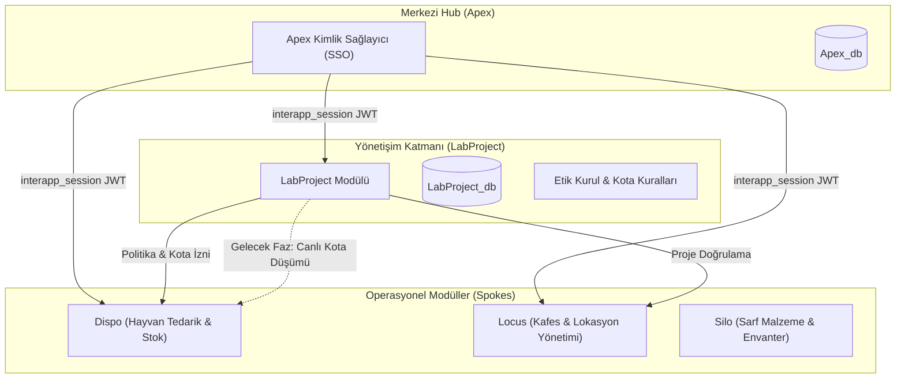
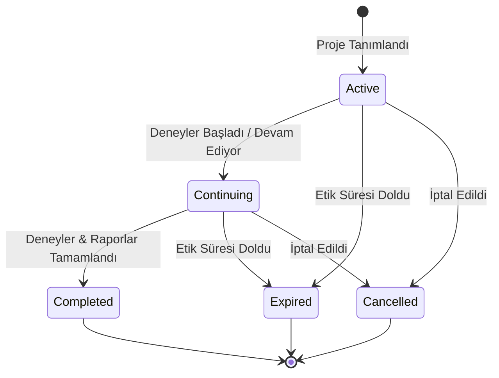

# LabProject - Ürün Vizyonu ve Mimari Blueprint

---

## 1. 🌟 Ürün Vizyonu ve Felsefesi

**LabProject**, Antigravity araştırma ekosisteminin **"Yönetişim, Denetim ve Kural Koyucu Katmanı" (Governance & Policy Layer)** olarak konumlandırılmıştır.

Biyomedikal araştırma laboratuvarlarında yürütülen deneylerin etik kurallara, yasal izinlere ve hayvan refahı mevzuatlarına tam uyum içinde sürdürülmesi birincil önceliktir. LabProject; proje başvurusu, Yerel Hayvan Deneyleri Etik Kurulu (HADYEK) onayları, çalışma takvimleri ve hayvan kotalarının yönetimini kağıt tabanlı ve dağınık tablolardan kurtararak **tek bir dijital doğruluk kaynağında (Single Source of Truth)** toplar.

### Temel Felsefe
1. **Sıfır İhlal İlkesi:** Hiçbir laboratuvar operasyonu, onaylanmış bir etik kurul izni ve tanımlı hayvan kotası olmadan başlatılamaz.
2. **Yaşayan Kotalar:** Hayvan hakları statik birer sayı değil; hayvan temininden (Dispo) kafesleme/barındırmaya (Locus) kadar tüm süreçlerde tüketimi canlı takip edilen bir muhasebe sistemidir.
3. **Şeffaf ve Proaktif Takip:** Araştırmacılar kotalarını ve kalan izin sürelerini şeffaf biçimde izler; yaklaşan bitiş tarihleri öngörülerek deneysel kesintiler önceden engellenir.

---

## 2. 🏛️ Ekosistem Rolü ve Mimari İlkeler (Apex Hub & Spoke)

Antigravity platformunda **Apex**, merkezi kimlik (SSO), kullanıcı yetkilendirme ve uygulama portalı görevi görür. LabProject ise Apex'e bağlı bağımsız bir **Spoke** servistir.

### Ekosistem İçi İşbirliği Prensipleri
- **Merkezi Yetkilendirme:** LabProject kullanıcıları Apex veritabanı üzerinden doğrulanır. Yalnızca `admin` veya `apps: ["labproject"]` izni olan araştırmacılar sisteme erişebilir.
- **Kural Sağlayıcı:** Diğer kardeş modüller (Dispo, Locus), üzerinde çalışılan projenin geçerliliğini ve kalan hayvan kotasını LabProject kurallarına göre değerlendirir.
- **Bağımsız Yaşam Döngüsü:** LabProject kendi veritabanına (`LabProject_db`) ve bağımsız Vercel Serverless dağıtımına sahiptir. Hub'daki geçici kesintilerden asgari düzeyde etkilenir.

---

## 3. 📋 İş Mantığı ve Domain Kuralları

### 3.1. Proje ve Etik Yaşam Döngüsü
- **Etik Numarası Bütünlüğü:** Her projenin resmi bir Yerel Etik Kurul Karar Numarası (`code`) bulunmalıdır (Örn: `2024/001`).
- **Tarih Bağımsızlığı:**
  - *Etik Kurul Süresi (`ethicsStartDate` - `ethicsEndDate`):* Yasal iznin geçerli olduğu resmi aralıktır.
  - *Proje Çalışma Süresi (`startDate` - `endDate`):* Deneylerin laboratuvarda fiilen yürütüldüğü tarih aralığıdır. Çalışma takvimi etik izin süresi sınırları içinde planlanmalıdır.
- **Tarih Mantık Kuralı:** İzin veya çalışma bitiş tarihleri hiçbir koşulda başlangıç tarihlerinden önce olamaz (`endDate >= startDate`).
- **İdari Uyumluluk Belgeleri:**
  - *Çalışma Kuralları Formu (`workRulesForm`):* Laboratuvar güvenlik ve biyogüvenlik taahhüdünün imzalanmış olması.
  - *Proje Defteri (`projectNotebook`):* Deney protokol kayıt defterinin zimmetlenmiş olması.

### 3.2. Granüler Hayvan Kota Muhasebesi
Hayvan izinleri yalnızca genel bir sayı olarak değil; **Tür**, **Suş** ve **Cinsiyet** ayrımında takip edilir:
- **Desteklenen Tür & Suş Matrisi:**
  - **Fare:** BALB/c, C57BL/6, CD-1 (ICR), Athymic Nude
  - **Sıçan:** Wistar, Sprague Dawley
  - **Tavşan:** New Zealand White
- **Cinsiyet Ayrımı:** `Erkek`, `Dişi`, `Erkek ve Dişi` (karma).
- **Kota Tüketim Dengesi:** `used` (kullanılan) değeri, tahsis edilen `count` (toplam kota) değerini aşamaz.

### 3.3. Proje Durumları (State Machine)

---

## 4. 🗺️ Tamamlanan Fazlar ve Yol Haritası (Roadmap)

### Faz 1: Temel Proje Yönetimi (Tamamlandı ✅)
- [x] CRUD altyapısı: Proje ekleme, düzenleme, silme ve detay görüntüleme.
- [x] Temel hayvan kotası tanımlama ve toplam sayı takibi.
- [x] MongoDB Atlas entegrasyonu ve doküman tabanlı modelleme.
- [x] Temel durum (`status`) yönetimi.

### Faz 2: Mimari Entegrasyon, Güvenlik ve Takvim (Tamamlandı ✅)
- [x] **Apex SSO Entegrasyonu:** Ön yüzden mock kullanıcı durumlarının kaldırılarak HTTP-only `interapp_session` çerezi ve `useAuth()` bağlamı ile tam entegrasyon sağlanması.
- [x] **Rol ve Yetkilendirme Denetimi:** `verifyAuthWithStatus` ile `401 Unauthorized` ve `403 Forbidden` durumlarının ayrıştırılması, test ortamı rozeti entegrasyonu.
- [x] **React Router DOM v7:** SPA mimarisinde `/`, `/new`, `/edit/:id`, `/timeline`, `/reports` rota altyapısının kurulması.
- [x] **Zod v4 API Doğrulamaları:** POST ve PUT isteklerinde nested kota yapıları, alan kırpılma (stripping) koruması ve `superRefine` tarih sıralama validasyonu.
- [x] **Proje Zaman Çizelgesi (`/timeline`):** 42 günlük dinamik takvim ızgarası, multi-day spanning row slot assignment algoritması ve etkinlik detay penceresi (backdrop blur).
- [x] **Otomatik Takvim Senkronizasyonu:** Proje ekleme/güncelleme/silme işlemlerinde `calendar` koleksiyonunun otomatik güncellenmesi.
- [x] **Admin Full Sync:** Veritabanındaki tüm tarihli projeleri tek tıkla takvime yeniden işleyen toplu senkronizasyon endpoint'i.
- [x] **Performans Optimizasyonu:** Liste görünümlerinde MongoDB projection uygulanarak veri aktarım hacminin düşürülmesi.
- [x] **Recharts İstatistik Paneli (`/reports`):** Proje durumlarının sayısal ve kategorik dağılım kartları.

### Faz 3: Ekosistem İçi Operasyonel Entegrasyon (Planlanıyor 🚀)
- [ ] **Dispo Modülü ile Çift Yönlü Kota Senkronizasyonu:**
  - Dispo üzerinden yapılan hayvan siparişlerinde veya kafesleme işlemlerinde ilgili projenin `quotas[].used` sayacının otomatik artırılması.
  - Kotası tükenen suşlar için Dispo'da otomatik sipariş blokajı.
- [ ] **Otomatik Uyarı ve Hatırlatma Bildirimleri:**
  - Etik izin bitişine 30 ve 60 gün kalan projeler için sistem yöneticisine ve yürütücüye (PI) e-posta/Apex içi bildirim gönderimi.
  - Kota doluluk oranı %90'a ulaşan projeler için erken uyarı sinyali.
- [ ] **PDF Rapor Çıktısı & Denetim Dosyası:**
  - Resmi denetimlerde (HADYEK, Bakanlık) sunulmak üzere tek tıkla standart formatta "Proje ve Hayvan Kullanım Durum Raporu" (PDF) üretimi.

### Faz 4: İleri Düzey Yetenekler ve Yapay Zekâ (Vizyon 🔮)
- [ ] **AI Destekli Etik Kurul Karar Analizi:**
  - Yüklenen resmi Etik Kurul Onay Kararı PDF dokümanlarının OCR ve LLM destekli taranarak proje kodu, PI adı, izin tarihleri ve hayvan kotalarının otomatik form doldurma ile sisteme işlenmesi.
- [ ] **Kullanım Trendi ve Tahmin Modeli:**
  - Laboratuvarın geçmiş 3 yıllık hayvan kullanım trendlerine göre mevsimsel suş ihtiyaçlarının tahmin edilmesi ve üreme planlamasına girdi sağlanması.
