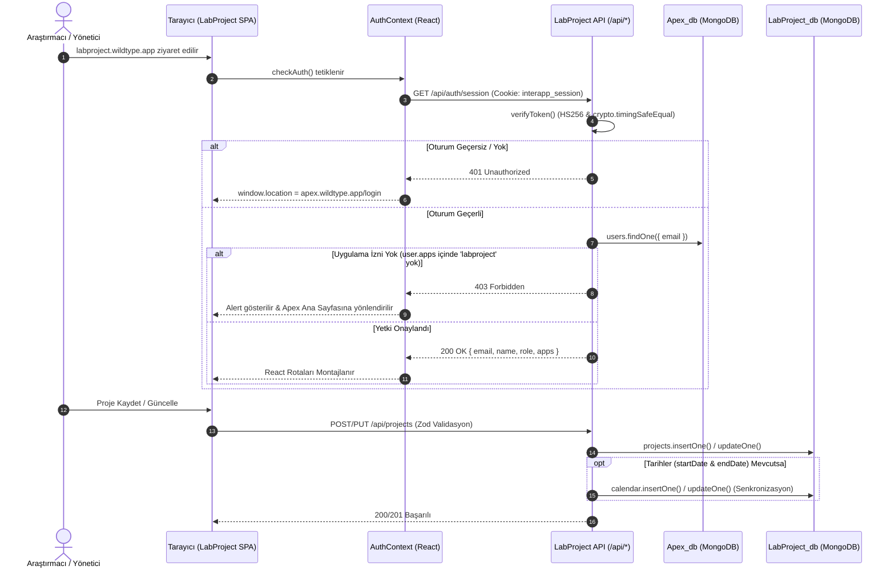
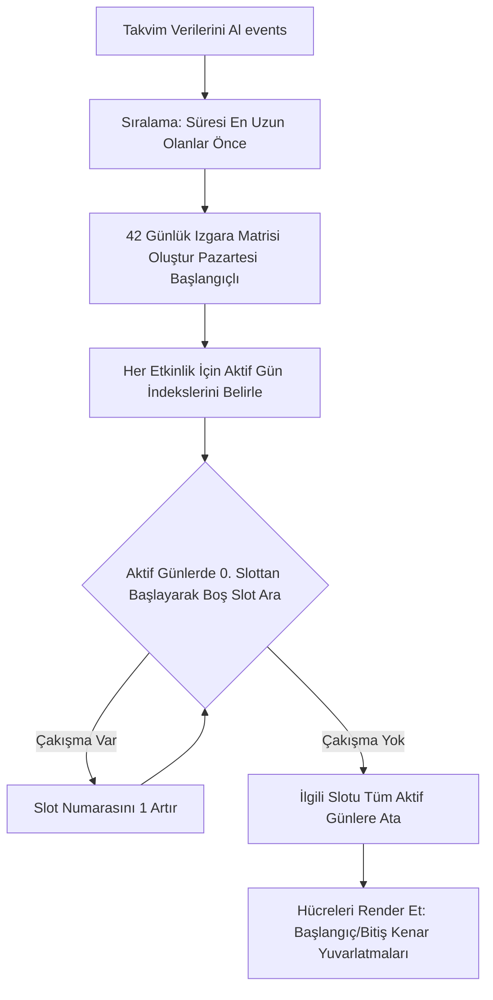

# LabProject - Teknik Dokümantasyon

Bu doküman, **LabProject** modülünün sistem mimarisini, veri modellerini, sunucusuz API endpoint'lerini, takvim zamanlama algoritmasını ve güvenlik mekanizmalarını teknik derinlikte detaylandırır.

---

## 1. 🏗️ Sistem Mimarisi & Apex Entegrasyonu

LabProject, Antigravity ekosisteminde **Yönetişim Katmanı (Governance Layer)** olarak görev yapar. Bağımsız bir Vite SPA ve Vercel Serverless mimarisi üzerinde koşarken, merkezi kimlik sağlayıcı olarak **Apex Hub** ile entegre çalışır.

### Hub & Spoke SSO ve Veri Akışı



### Dinamik Veritabanı ve Çerez Çözümleme Mantığı (`lib/mongodb.js`)

LabProject, ortam durumuna göre veritabanını ve oturum çerezi adını dinamik olarak izole eder:

```javascript
// Ortam tespiti
export function isProdEnv() {
    return process.env.VERCEL_ENV === 'production' || process.env.FORCE_PROD_DB === 'true';
}

// Veritabanı adı çözümleme
export function getDbName(baseName) {
    if (isProdEnv()) return baseName;
    return baseName.endsWith('_db')
        ? baseName.replace(/_db$/, '_test_db')
        : `${baseName}_test`;
}

// Oturum çerezi adı çözümleme
export function getSessionCookieName() {
    return isProdEnv() ? 'interapp_session' : 'interapp_session_test';
}
```

- **Canlı Ortam:** Veritabanı `LabProject_db`, Apex kullanıcıları `Apex_db`, çerez `interapp_session`.
- **Önizleme / Test Ortamı:** Veritabanı `LabProject_test_db`, Apex kullanıcıları `Apex_test_db`, çerez `interapp_session_test`.

---

## 2. 📂 Tam Dizin Ağacı

```
/Users/oguzhan/Antigravity/LabProject/
├── api/
│   ├── auth/
│   │   └── session.js          # SSO oturum sorgulama (GET) & çıkış (POST/DELETE)
│   ├── calendar.js             # Takvim listeleme (GET) & Admin Toplu Eşitleme (POST)
│   └── projects.js             # Projeler CRUD & Takvim senkronizasyon kancaları
├── lib/
│   ├── auth.js                 # JWT doğrulama, timingSafeEqual, RBAC kontrolü
│   └── mongodb.js              # MongoClient Singleton havuzu & getDbName yardımcıları
├── src/
│   ├── components/
│   │   └── Layout.jsx          # Ortak düzen: Üst bar, navigasyon, profil & Apex hızlı geçişi
│   ├── context/
│   │   └── AuthContext.jsx     # İstemci oturum yöneticisi, 401/403 yönlendirmesi
│   ├── pages/
│   │   ├── ProjectCalendar.jsx # Çoklu gün yayılımlı interaktif takvim bileşeni
│   │   ├── ProjectForm.jsx     # Proje & hayvan kotaları düzenleme/ekleme formu
│   │   ├── ProjectList.jsx     # Proje listesi tablosu, arama ve durum filtresi
│   │   └── ProjectReports.jsx  # Durum bazlı sayaçlar ve analitik rapor kartları
│   ├── App.jsx                 # React Router v7 yönlendirmeleri ve state yönetimi
│   ├── index.css               # Tailwind CSS temel ve bileşen kuralları
│   └── main.jsx                # React DOM kök montaj dosyası
├── dist/                       # Vite build derleme çıktıları
├── public/                     # Statik varlıklar
├── index.html                  # HTML şablonu
├── package.json                # Proje bağımlılıkları ve npm script'leri
├── postcss.config.js           # PostCSS Tailwind eklenti ayarı
├── tailwind.config.js          # Tailwind tema yapılandırması
├── vercel.json                 # Vercel yönlendirme kuralları (SPA rewrite & API passthrough)
├── vite.config.js              # Vite React eklenti yapılandırması
├── README.md                   # Proje tanıtım ve kurulum rehberi
├── TECHNICAL.md                # Detaylı teknik mimari ve API referansı
└── BLUEPRINT.md                # Vizyon, iş kuralları ve faz yol haritası
```

---

## 3. 🗄️ Veritabanı ve Şema Spesifikasyonu

LabProject, MongoDB üzerinde doküman tabanlı çalışır. Koleksiyonlar `LabProject_db` altında yer alır:

### 3.1. Koleksiyon: `projects`
Laboratuvardaki tüm araştırma projelerinin kayıtlarını, etik izinlerini ve hayvan kotalarını barındırır.

| Alan Adı | Tip | Zorunlu? | Varsayılan | Açıklama |
|---|---|---|---|---|
| `_id` | `ObjectId` | Evet | Otomatik | Benzersiz kayıt kimliği |
| `title` | `String` | Evet | - | Projenin tam adı / başlığı |
| `code` | `String` | Evet | - | Yerel Etik Kurul Onay Numarası (Örn: `2024/001`) |
| `protocol` | `String` | Hayır | `""` | Laboratuvar protokol / çalışma referans numarası |
| `pi` | `String` | Evet | - | Sorumlu Araştırmacı (Principal Investigator) adı |
| `ethicsStartDate` | `String (YYYY-MM-DD)` | Hayır | - | Etik Kurul izin başlangıç tarihi |
| `ethicsEndDate` | `String (YYYY-MM-DD)` | Hayır | - | Etik Kurul izin bitiş tarihi |
| `startDate` | `String (YYYY-MM-DD)` | Hayır | - | Laboratuvar fiili çalışma başlangıç tarihi |
| `endDate` | `String (YYYY-MM-DD)` | Hayır | - | Laboratuvar fiili çalışma bitiş tarihi |
| `status` | `String` | Hayır | `"Active"` | Durum: `Active`, `Continuing`, `Completed`, `Cancelled`, `Expired` |
| `workRulesForm` | `Boolean` | Hayır | `false` | Çalışma Kuralları Formu teslim edildi mi? |
| `projectNotebook` | `Boolean` | Hayır | `false` | Proje Defteri teslim/zimmet durumu |
| `animalQuota` | `Number (Int)` | Hayır | `0` | Genel hayvan kotası (özet) |
| `budget` | `Number` | Hayır | `0` | Proje bütçesi |
| `description` | `String` | Hayır | `""` | Proje detay açıklaması ve notlar |
| `quotas` | `Array<QuotaObject>` | Hayır | `[]` | Granüler hayvan kullanım kotaları (ayrıntısı aşağıda) |
| `createdAt` | `Date` | Evet | `new Date()` | Proje oluşturulma zaman damgası |
| `updatedAt` | `Date` | Hayır | - | Proje son güncelleme zaman damgası |

#### `quotas` Alt Doküman Şeması:
```json
{
  "species": "Fare",
  "strain": "BALB/c",
  "sex": "Erkek",
  "count": 50,
  "used": 12
}
```
- `species` (String): Tür (`Fare`, `Sıçan`, `Tavşan`).
- `strain` (String): Suş (Örn: `BALB/c`, `C57BL/6`, `Wistar`, `Sprague Dawley`, `New Zealand White`).
- `sex` (String): Cinsiyet (`Erkek`, `Dişi`, `Erkek ve Dişi`).
- `count` (Integer): Projeye tahsis edilen maksimum kota (non-negative).
- `used` (Integer): Deneylerde şu ana kadar fiilen kullanılan hayvan sayısı (non-negative).

---

### 3.2. Koleksiyon: `calendar`
Projelerin takvim zaman çizelgesinde (`/timeline`) yüksek performansla render edilebilmesi için normalize edilmiş takvim koleksiyonu.

| Alan Adı | Tip | Zorunlu? | Açıklama |
|---|---|---|---|
| `_id` | `ObjectId` | Evet | Benzersiz takvim etkinliği kimliği |
| `projectId` | `ObjectId` | Evet | İlgili projenin `projects._id` referansı |
| `title` | `String` | Evet | Proje başlığı |
| `pi` | `String` | Evet | Yürütücü adı |
| `code` | `String` | Evet | Etik No |
| `startDate` | `String (YYYY-MM-DD)` | Evet | Çalışma başlangıç tarihi |
| `endDate` | `String (YYYY-MM-DD)` | Evet | Çalışma bitiş tarihi |
| `color` | `String (HEX)` | Evet | Etkinlik rengi (Örn: `#3B82F6`, `#10B981`, `#EF4444` vb.) |
| `createdAt` | `Date` | Evet | Oluşturulma tarihi |

---

## 4. 🔌 Tam API Referansı

Tüm API endpoint'leri `/api` ön ekiyle çağrılır. Her istek öncesinde `interapp_session` çerezinden kimlik ve uygulama yetkisi (`verifyAuthWithStatus`) denetlenir.

---

### 4.1. Kimlik ve Oturum API (`/api/auth/session`)

#### `GET /api/auth/session`
Mevcut istemcinin oturumunu doğrular ve kullanıcı profilini döndürür.

- **Yetki:** Geçerli SSO çerezi ve `labproject` uygulama erişimi (veya `admin` rolü).
- **Başarılı Yanıt (`200 OK`):**
  ```json
  {
    "email": "oguzhan@wildtype.app",
    "name": "Oğuzhan",
    "role": "admin",
    "apps": ["apex", "labproject", "dispo", "silo"]
  }
  ```
- **Hata Yanıtları:**
  - `401 Unauthorized`: `{ "error": "Oturum bulunamadı." }` veya `{ "error": "Geçersiz veya süresi dolmuş oturum." }`
  - `403 Forbidden`: `{ "error": "Bu uygulamaya erişim yetkiniz bulunmamaktadır." }`

#### `DELETE /api/auth/session` veya `POST /api/auth/session`
Oturumu sonlandırır; `.wildtype.app` kapsamındaki oturum çerezini sıfırlar (`Max-Age=0`).

- **Başarılı Yanıt (`200 OK`):**
  ```json
  {
    "message": "Logged out"
  }
  ```

---

### 4.2. Projeler API (`/api/projects`)

#### `GET /api/projects`
Projeleri listeler veya ID ile tekil proje çeker.

- **Sorgu Parametreleri:**
  - `id` (Opsiyonel): Projenin 24 karakterlik MongoDB `ObjectId` değeri.
- **Davranış:**
  - `id` belirtilmemişse: Tüm projelerin özet projeksiyonu çekilir (`title, code, pi, ethicsStartDate, ethicsEndDate, status, createdAt`), `_id: -1` ile tersten sıralanır.
  - `id` belirtilmişse: Projenin tüm alanları (kotalar, açıklamalar vb.) tekil doküman olarak döndürülür.
- **Başarılı Yanıt (`200 OK` - Liste):**
  ```json
  [
    {
      "id": "673f1a2b8e1a2c0012345678",
      "title": "Metabolik Sendromda Karaciğer Rejenerasyonu",
      "code": "2024/042",
      "pi": "Prof. Dr. Ahmet Yılmaz",
      "ethicsStartDate": "2024-01-15",
      "ethicsEndDate": "2025-01-15",
      "status": "Active",
      "createdAt": "2024-01-15T10:00:00.000Z"
    }
  ]
  ```

#### `POST /api/projects`
Sisteme yeni bir araştırma projesi kaydeder. Projede `startDate` ve `endDate` mevcutsa otomatik olarak `calendar` koleksiyonuna takvim etkinliği açar.

- **Request Body (Zod Şeması):**
  ```json
  {
    "title": "İskemi Reperfüzyon Modelinde Antioksidan Etki",
    "code": "2024/088",
    "protocol": "PRT-2024-B",
    "pi": "Doç. Dr. Ayşe Kaya",
    "ethicsStartDate": "2024-03-01",
    "ethicsEndDate": "2025-03-01",
    "startDate": "2024-04-01",
    "endDate": "2024-06-30",
    "status": "Active",
    "workRulesForm": true,
    "projectNotebook": false,
    "quotas": [
      {
        "species": "Fare",
        "strain": "C57BL/6",
        "sex": "Erkek",
        "count": 40,
        "used": 0
      }
    ]
  }
  ```
- **Zod Validasyon Kuralları:**
  - `title`, `code`, `pi`: Zorunlu, en az 1 karakter.
  - `ethicsStartDate <= ethicsEndDate` kontrolü (superRefine).
  - `startDate <= endDate` kontrolü (superRefine).
  - `count` ve `used`: Negatif olamaz (`nonnegative`).
- **Başarılı Yanıt (`201 Created`):**
  ```json
  {
    "id": "6740b2a19f2b3d0012987654",
    "title": "İskemi Reperfüzyon Modelinde Antioksidan Etki",
    "code": "2024/088",
    "status": "Active",
    "createdAt": "2024-03-01T14:30:00.000Z"
  }
  ```

#### `PUT /api/projects`
Mevcut projeyi günceller ve takvim senkronizasyonunu yönetir.

- **Request Body:** Proje ID'si zorunludur (`id`), diğer alanlar kısmi (`partial()`) olarak gönderilebilir.
- **Takvim Senkronizasyon Kuralı:**
  - `startDate` ve `endDate` doluysa: `calendar` koleksiyonundaki etkinlik güncellenir; yoksa yeni renk atanarak oluşturulur.
  - `startDate` veya `endDate` boş string (`""`) yapıldıysa: Takvimdeki etkinlik silinir.
- **Başarılı Yanıt (`200 OK`):**
  ```json
  { "success": true }
  ```

#### `DELETE /api/projects`
Projeyi ve varsa ilişkili tüm takvim etkinliklerini siler.

- **Request Payload / Query:** `?id={id}` veya `{ "id": "{id}" }`
- **Başarılı Yanıt (`200 OK`):**
  ```json
  { "success": true }
  ```

---

### 4.3. Takvim API (`/api/calendar`)

#### `GET /api/calendar`
Takvimde render edilmek üzere kayıtlı tüm proje çalışma aralıklarını döner.

- **Başarılı Yanıt (`200 OK`):**
  ```json
  [
    {
      "id": "6741c3d40e3c4e0013abcdef",
      "projectId": "673f1a2b8e1a2c0012345678",
      "title": "Metabolik Sendromda Karaciğer Rejenerasyonu",
      "pi": "Prof. Dr. Ahmet Yılmaz",
      "code": "2024/042",
      "startDate": "2024-05-01",
      "endDate": "2024-07-15",
      "color": "#3B82F6",
      "createdAt": "2024-05-01T09:00:00.000Z"
    }
  ]
  ```

#### `POST /api/calendar` (Admin Full Sync)
Yalnızca `admin` rolü tarafından çalıştırılabilir. `calendar` koleksiyonundaki tüm verileri siler, `projects` koleksiyonundaki `startDate` ve `endDate` tanımlı tüm projeleri tarar ve döngüsel renk paleti atayarak takvim veritabanını baştan oluşturur.

- **Yetki:** `user.role === 'admin'` zorunludur (aksi halde `403 Forbidden`).
- **Başarılı Yanıt (`200 OK`):**
  ```json
  {
    "success": true,
    "message": "Bütün projeler başarıyla takvimle senkronize edildi!"
  }
  ```

---

## 5. 📅 Takvim Algoritması: Multi-Day Spanning & Slot Assignment

`ProjectCalendar.jsx` bileşeni, projelerin aylık takvimde birbirini ezmeden ve görsel sürekliliği koruyarak gösterilmesini sağlayan bir **Satır Slotu Tahsis Algoritması** kullanır:



1. **Önceliklendirme:** Etkinlikler sürelerine göre büyükten küçüğe (`durationB - durationA`), ardından başlangıç tarihlerine göre sıralanır. Böylece uzun süreli projeler alt satırlarda kesintiye uğramadan üst slotlara yerleşir.
2. **Çakışma Tespiti:** Projenin kapsadığı tüm gün indeksleri (`activeIndices`) taranır. Hepsinin boş olduğu ilk ortak slot indeksi (`slot = 0, 1, 2...`) tespit edilir.
3. **Izgara Sürekliliği:**
   - Projenin ilk gününde sol kenar yuvarlatılır (`rounded-l-lg`).
   - Projenin son gününde sağ kenar yuvarlatılır (`rounded-r-lg`).
   - Proje başlığı, projenin başladığı gün veya her haftanın Pazartesi gününde tekrar görüntülenerek okunabilirlik artırılır.

---

## 6. 🌐 Ön Yüz Mimarisi ve Rota Tablosu

React 18 ve React Router DOM v7 ile istemci taraflı sayfa yönlendirmesi:

| Rota (Path) | Bileşen | Açıklama |
|---|---|---|
| `/` | `ProjectList` | Projelerin listelendiği, arama ve durum filtresinin bulunduğu ana panel. |
| `/new` | `ProjectForm` | Yeni araştırma projesi ve hayvan kotaları tanımlama ekranı. |
| `/edit/:id` | `EditProjectRoute` -> `ProjectForm` | Seçili projenin sunucudan lazy-load edilip düzenlendiği ekran. |
| `/edit` | `<Navigate to="/" replace />` | Hatalı/parametresiz düzenleme çağrılarında ana sayfaya güvenli yönlendirme. |
| `/timeline` | `ProjectCalendar` | Projelerin çalışma aralıklarını gösteren interaktif takvim görünümü. |
| `/reports` | `ProjectReports` | Durum bazlı istatistik sayaçları ve özet rapor kartları. |

### Sayfa Düzeyi Durum Korunumu
`App.jsx` seviyesinde tutulan `paginationState` (sayfa numarası, sayfa başı kayıt), `statusFilter` ve `searchTerm` durumları sayesinde kullanıcı proje düzenleyip listeye geri döndüğünde arama ve sayfalama konumu kaybolmaz.

---

## 7. 🔐 Güvenlik Mekanizmaları ve Hata Yönetimi

1. **Sabit Zamanlı İmza Doğrulaması (`crypto.timingSafeEqual`):**
   Gelen JWT imzası ile hesaplanan HMAC SHA256 imzası karşılaştırılırken zamanlama analizi saldırılarını (timing attack) önlemek amacıyla doğrudan string karşılaştırması yerine Buffer düzeyinde sabit zamanlı kıyaslama uygulanır.
2. **Algoritma Sabitlemesi (Algorithm Pinning):**
   Yalnızca `HS256` algoritması kabul edilir (`header.alg === 'HS256'`). `none` algoritması saldırıları engellenir.
3. **XSS & Çerez Güvenliği:**
   Oturum çerezi `HttpOnly` bayrağıyla JavaScript erişimine kapalıdır. `SameSite=Lax` ile CSRF riskleri azaltılır.
4. **Veri Sanitizasyonu ve Enjeksiyon Koruması:**
   Zod şemaları ile gelen veri zorunlu tiplere dönüştürülür (`z.coerce.number()`), tanımsız alanlar soyulur ve MongoDB enjeksiyonlarına olanak tanıyan operatörler temizlenir.
